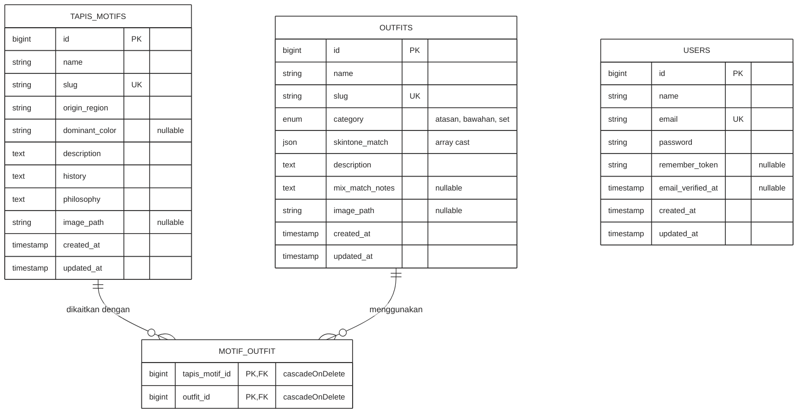
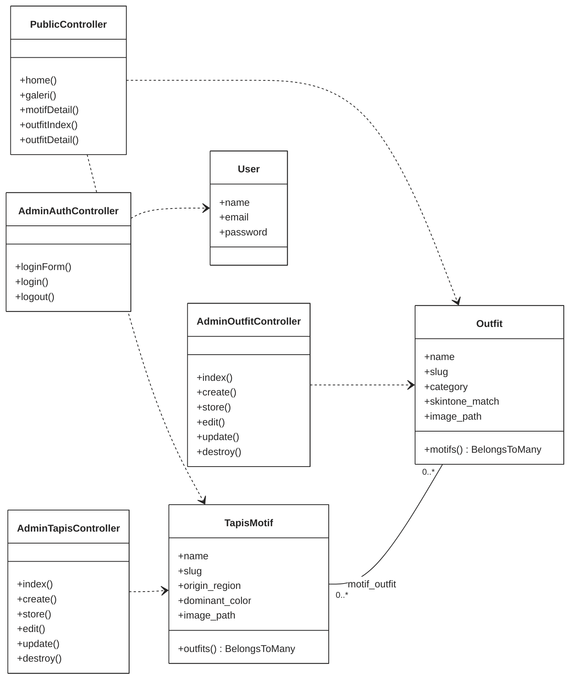
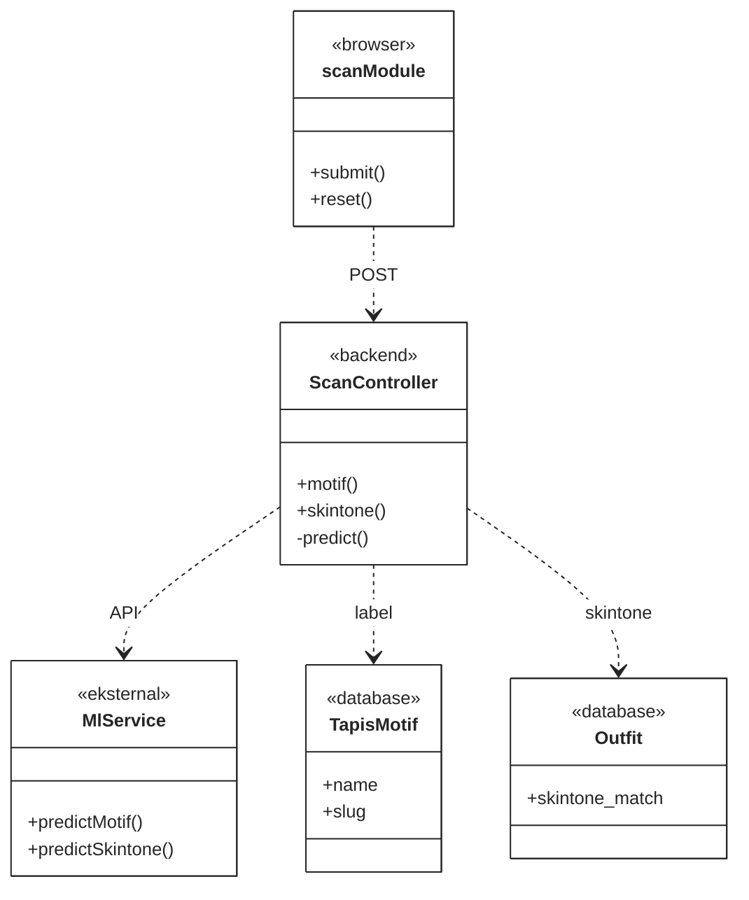

# ERD & Class Diagram: KAINARA

## 1. Entity-Relationship Diagram (ERD)

ERD hanya memuat **tabel database**. Fitur scan tidak masuk ERD karena scan tidak menyimpan apa pun ke database: alurnya stateless (unggah file sementara, kirim ke API ML, hapus file, cocokkan hasil ke tabel yang ada). ERD hanya menggambar data yang tersimpan, jadi scan tidak punya entitas di sini.

Tabel infrastruktur bawaan Laravel (bukan domain, tidak digambar): `migrations` (pencatatan versi skema). Tabel `cache`, `cache_locks`, `jobs`, `job_batches`, `failed_jobs`, `password_reset_tokens` sudah dihapus karena tidak dipakai (cache dan queue beralih ke file/sync).

---

## 2. Class Diagram: Domain Aplikasi

Class diagram dibagi dua agar rapi: diagram ini untuk domain inti (model + controller CRUD/paging), diagram terpisah di bagian 3 untuk alur scan.

Relasi `TapisMotif` - `Outfit` many-to-many via tabel pivot `motif_outfit`. Semua class model memakai `slug` sebagai route key (`getRouteKeyName()`).

---

## 3. Class Diagram: Alur Scan

Diagram fokus alur scan saja, dari browser sampai hasil. Node ditekan ke lima class inti: facade `Http` dan `Storage` tidak digambar terpisah karena hanya detail implementasi, mereka disebut di penjelasan langkah.

Alur per langkah:
1. `scanModule` (Alpine.js) validasi gambar (JPG/PNG/WEBP, maks 2 MB) lalu `fetch POST` ke `/scan/motif` atau `/scan/skintone` (`throttle:10,1`).
2. `ScanController::predict()` simpan file via facade `Storage` ke `storage/scan-temp`, kirim ke ML via facade `Http::attach()`, hapus file di semua jalur (sukses, error jaringan, respons gagal).
3. Hasil dicocokkan ke database yang sudah ada: label motif ke `TapisMotif::name` (case-insensitive), skintone ke `Outfit::skintone_match` via `whereJsonContains`.
4. Respons JSON kembali ke browser, ditampilkan, tidak disimpan ke database.

Dilewati: `scanPageStore` (favorit) tidak relevan untuk alur scan, ditiadakan dari diagram.
Risiko: tidak ada. Basis kode asli: `ScanController.php`, `resources/js/app.js`, `config/services.php`.
